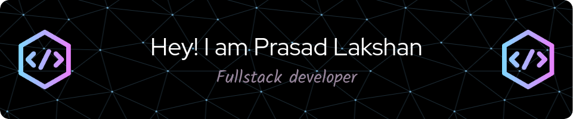

<h3 align="center">Programming Languages and Tools</h3>

  

  

  

  
<!--  -->

<!--  -->

<a href="https://github.com/Prasadkpd/github-readme-stats">
  
<!--    -->
</a>

<!--  
 -->

  
  

 

<!-- <h3 align="center">Most Worked Repositories</h3>

  
                                                        

 -->

    
### Connect Me Through

### Familiar Operating Systems & Tools

 
